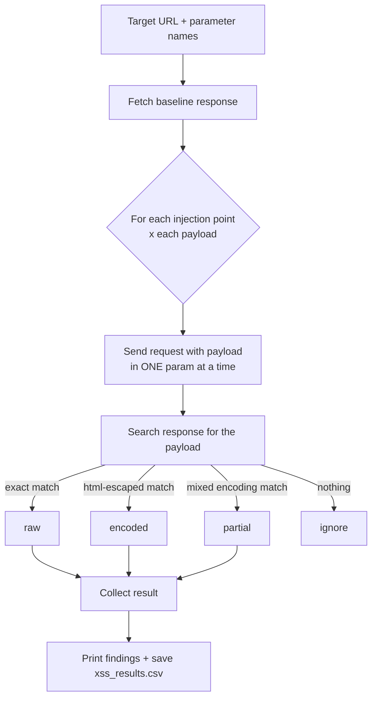

# xsstester

A small, fast **reflected-XSS scanner** written in Python. Point it at a URL, tell it which parameters to poke, and it fires a list of XSS payloads at every injection point (GET params, POST fields, HTTP headers, cookies), then reports where your input comes back in the response and **how** it came back: raw, HTML-encoded, or partially encoded.

It's a triage tool, not an exploit framework. It answers one question quickly: *"Does this app reflect my input without sanitizing it?"*

> ⚠️ **Only test targets you own or have explicit written permission to test** (your own lab, DVWA, Juice Shop, or a bug bounty program's in-scope assets). Unauthorized scanning is illegal.

---

## Table of contents

- [How it works](#how-it-works)
- [Install](#install)
- [Quick start](#quick-start)
- [Command-line options](#command-line-options)
- [Reading the results](#reading-the-results)
- [Custom payloads](#custom-payloads)
- [Request volume](#request-volume)
- [Limitations](#limitations)
- [Project layout](#project-layout)
- [Responsible use](#responsible-use)

---

## How it works



Step by step:

1. **Baseline.** Before testing, the tool requests the page once per vector type (GET, POST, headers) with no payload.
2. **Inject, one thing at a time.** For every parameter you list, it sends each payload with *only that parameter* changed. Existing query-string params in your URL are preserved. For POST, the other listed fields are sent as empty strings.
3. **Detect reflection.** Each response is searched for the payload in three tiers:

   | Tier | What the tool checks | What it means |
   |---|---|---|
   | `raw` | The exact payload string appears in the response | Input is reflected **unescaped**. This is your candidate. |
   | `encoded` | `html.escape(payload)` appears in the response (`<` → `&lt;`, `"` → `&quot;`, `'` → `&#x27;`) | Input is reflected but **output-encoded**. Usually safe in HTML context. |
   | `partial` | A regex where each of `< > / "` may be either raw or escaped matches | Mixed or inconsistent encoding. Worth a manual look. |

4. **Report.** Findings are printed with a ~160-char context snippet and saved to `xss_results.csv`.

The four vectors it tests:

| Vector | How the payload is delivered |
|---|---|
| **GET param** | Added/overwritten in the URL query string |
| **POST param** | Sent as form-encoded body (`application/x-www-form-urlencoded`) |
| **HEADER** | Sent as the value of the named request header (e.g. `Referer`, `X-Forwarded-For`) |
| **COOKIE** | Sent as the value of the named cookie |

---

## Install

Requires **Python 3.8+**.

```bash
git clone https://github.com/Xmyronn/xsstester.git
cd xsstester
python3 -m pip install --user requests beautifulsoup4
```

(`beautifulsoup4` is imported by the script but not currently used for detection.)

---

## Quick start

Scan with all defaults against a local test page:

```bash
python3 xsstester.py "http://localhost/page.php"
```

Choose exactly which parameters to test:

```bash
python3 xsstester.py "http://localhost/page.php" \
    --get-params q id \
    --post-params comment \
    --payloads-file payloads.txt
```

Slow it down for a fragile or rate-limited target:

```bash
python3 xsstester.py "http://localhost/page.php" --get-params q --rate 1.0
```

Test only specific headers and cookies:

```bash
python3 xsstester.py "http://localhost/page.php" \
    --get-params q \
    --post-params comment \
    --headers Referer X-Forwarded-For \
    --cookies theme
```

> **Quote your URL** if it contains `&` or `?` so your shell doesn't swallow it.

**Safe places to practice:** [DVWA](https://github.com/digininja/DVWA), [OWASP Juice Shop](https://github.com/juice-shop/juice-shop), or your own throwaway localhost page.

---

## Command-line options

```
python3 xsstester.py URL [options]
```

| Option | Default | Description |
|---|---|---|
| `url` | *(required)* | Full target URL, e.g. `http://localhost/page.php` |
| `--get-params ...` | `q search id name` | GET parameter names to inject into |
| `--post-params ...` | `username email comment message` | POST form field names to inject into |
| `--headers ...` | `User-Agent Referer X-Forwarded-For` | Request header names to inject into |
| `--cookies ...` | `session theme username` | Cookie names to inject into |
| `--payloads-file PATH` | built-in list | Text file of payloads, one per line |
| `--rate SECONDS` | `0.2` | Delay between requests |

Pass an empty list to skip a vector, e.g. `--cookies` with no values.

### Built-in payloads

```
<script>alert(1)</script>
"><script>alert(1)</script>
';alert(1);//

<svg/onload=alert(1)>
<body onload=alert(1)>
<iframe srcdoc='<script>alert(1)</script>'></iframe>
```

These cover the common contexts: plain HTML body, breaking out of an attribute (`">`), breaking out of a JS string (`';`), and event-handler-based vectors.

---

## Reading the results

Console output:

```
[*] Building baseline and starting scans...
[*] Scanning GET params: ['q', 'name']
[*] Scanning POST params: ['comment']
[*] Scanning headers: ['User-Agent', 'Referer'] and cookies: ['session']
[!] Potential reflections found:
 - GET param q -> raw (payload=<script>alert(1)</script>)
   snippet: <html><body>You searched: <script>alert(1)</script> | Hello  | UA: xss-tester/1.0</body></html>
 - GET param name -> encoded (payload=<script>alert(1)</script>)
   snippet: <html><body>You searched:  | Hello &lt;script&gt;alert(1)&lt;/script&gt; | UA: xss-tester/1.0</body></html>
[+] Results saved to xss_results.csv
```

**What to chase:**

- 🔴 **`raw`** is the one that matters. Open the page in a browser and confirm the payload actually executes. Reflection alone is not proof of XSS.
- 🟡 **`partial`** means the app encodes some characters but not others. Look at the snippet and try to craft a payload that survives.
- ⚪ **`encoded`** means the app is escaping output. Usually not exploitable in an HTML context, but check whether the same value is reflected somewhere else (JS block, attribute, URL) where HTML-encoding isn't enough.

### CSV output

Results are written to `xss_results.csv` in the current directory (**overwritten on each run**):

| Column | Meaning |
|---|---|
| `vector` | `GET param`, `POST param`, `HEADER`, or `COOKIE` |
| `param` | The parameter/header/cookie name that was injected |
| `payload` | The payload that was reflected |
| `type` | `raw`, `encoded`, or `partial` |
| `status_code` | HTTP status of the test response |
| `snippet` | Surrounding response text around the reflection |
| `tested_url` | The exact URL requested (GET/POST rows only) |

If nothing is found, no CSV is written.

---

## Custom payloads

Create a plain text file with one payload per line:

```text
<script>alert(document.domain)</script>
">
javascript:alert(1)
<details open ontoggle=alert(1)>
```

```bash
python3 xsstester.py "http://localhost/page.php" --get-params q --payloads-file my_payloads.txt
```

Blank lines are skipped and each line is whitespace-stripped. A custom file **replaces** the built-in list, it doesn't add to it.

---

## Request volume

Total requests ≈ **(number of injection points) × (number of payloads)** + 3 baseline requests.

With the defaults that is (4 GET + 4 POST + 3 headers + 3 cookies) × 7 payloads = **98 test requests**, spaced `--rate` seconds apart. Large payload files and long parameter lists add up quickly, so raise `--rate` and trim your parameter lists on live targets.

---

## Limitations

Know what this tool does *not* do, so you don't trust a clean result too much:

- **Detects reflection, not execution.** No browser or JS engine is involved. A `raw` hit still needs manual confirmation (context, CSP, content-type, etc.).
- **Reflected XSS only.** It won't find stored XSS (payload shown on a *different* page later) or DOM-based XSS (client-side only).
- **Single page.** No crawling, no form discovery. You give it the URL and the parameter names.
- **No authentication support yet.** Cookies and headers are fixed at startup (`User-Agent` only), so pages behind a login can't be tested as-is. `--cookies` tests cookie *names* with payload values; it can't send your real session.
- **Simple POST handling.** Form-encoded only, so no JSON bodies, multipart uploads, or CSRF-token handling.
- **Guessing parameter names.** It only tests names you list (or the defaults). Hidden parameters won't be found.
- **Payload matching is literal.** Apps that transform input in other ways (case-folding, stripping tags, URL-encoding in output) can slip past the three detection tiers.
- **`partial` snippets can be empty** when the first 50 chars of the payload aren't found verbatim in the response.

---

## Project layout

```
xsstester/
├── xsstester.py      # the whole tool
├── requirments.txt   # install notes
└── usage             # example command
```

Key functions in `xsstester.py`:

| Function | Job |
|---|---|
| `get_baseline()` | Fetch the unmodified page for comparison |
| `inject_into_url()` | Set one query param to a payload, keep the rest |
| `find_reflection()` | The three-tier raw / encoded / partial check |
| `extract_context()` | Cut a snippet around the match for the report |
| `scan_get()` / `scan_post()` | Loop params × payloads for GET and POST |
| `scan_headers_and_cookies()` | Same loop for headers and cookies |
| `save_results_csv()` | Write findings to `xss_results.csv` |

---

## Responsible use

This tool sends many requests containing script payloads. Use it only on:

- systems you own,
- intentionally vulnerable labs, or
- targets that are **in scope** for a bug bounty or have written authorization.

Respect program rules on rate limits and automated testing, and report findings responsibly. You are responsible for how you use it.
